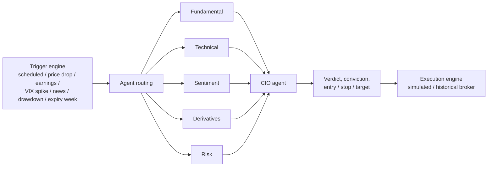

# Agentic Trading System

A multi-agent LLM research system for Indian equities (NSE/BSE), built on **LangGraph**. Six specialised agents analyse a stock, a CIO agent synthesises their reports into a verdict with entry, stop-loss and target, and a **trigger engine** decides which agents are worth running for a given market event. An event-driven backtester replays the same pipeline day by day.

> **Research project, not financial advice.** The system has never traded real money and makes no claim of live performance. See [Limitations](#limitations).

## How it works



- **Agents** (`src/agents`): Fundamental, Technical, Sentiment, Derivatives, Risk and CIO, all subclasses of a shared `BaseAgent`. The first five run on local models through Ollama; the CIO uses a hosted model via Groq for its longer context.
- **Trigger-based routing** (`src/trading/types.py`, `src/agents/routing.py`): not every event needs every agent. A scheduled monthly review runs all six; a price drop runs Technical, Sentiment, Risk and CIO; a max-drawdown breach runs only Risk and CIO as a circuit breaker. Expiry week skips the Derivatives agent (see below).
- **State** (`src/agents/langgraph_orchestrator.py`): a typed LangGraph `AgenticState` that holds only structured *summaries*, never raw data, with a `MemorySaver` checkpointer. Raw data stays in the Python layer. This keeps the LLM context small on an 8 GB GPU.
- **VRAM-aware execution** (`src/llm`): agents run strictly one at a time and the model is unloaded between agents.
- **Backtesting** (`src/backtesting`): an event-driven backtester that replays the trigger engine, risk rules and execution engine day by day, evaluating triggers using only data available before each day. **It does not call the LLM agents**: signals come from a rule-based stand-in (RSI, moving averages, ATR), because replaying six LLM agents over years of history is too slow and would leak the models' training-data knowledge. The package also has grid and random search, walk-forward analysis, out-of-sample validation and an overfitting detector.
- **Dashboard** (`dashboard`): a Streamlit app with market context, agent reports, a CIO terminal, a position calculator and a backtest hub.

### A design decision worth noting

During expiry week, open interest and put-call ratio drop mechanically as contracts roll. The Derivatives agent read this as institutions abandoning a stock, and a flag in the prompt did not stop it. The fix was structural: the router skips that agent in expiry week (`TriggerType.EXPIRY_WEEK`). The reasoning is in [docs/design.md](docs/design.md).

## Quick start

Requires Python 3.11+, [Ollama](https://ollama.com) with a local model, and (for the CIO agent) a Groq API key.

```bash
pip install -r requirements.txt
cp .env.example .env        # then fill in GROQ_API_KEY, NEWSAPI_KEY, etc.

# Screen the NIFTY 50, then analyse the top picks
python -m src.pipeline.orchestrator --screener --top-n 5

# Analyse a single stock
python -m src.pipeline.orchestrator --stock RELIANCE

# Dashboard
streamlit run dashboard/app.py
```

Optional NSE option-chain data for the Derivatives agent: `pip install -r requirements-optional.txt`. Check the data provider's terms first. Without it the agent degrades gracefully.

## Tests

```bash
pytest                 # 332 tests, no network needed
pytest -m network      # tests that need live market data
```

CI runs the suite on every push (`.github/workflows/tests.yml`).

## Project layout

```
src/
  agents/        six agents, routing, LangGraph orchestrator
  backtesting/   event-driven backtester, optimisers, metrics, regime detection
  data/          market data, fundamentals, news, derivatives, summariser
  llm/           Ollama client, Groq client, VRAM manager
  pipeline/      screening -> analysis -> ranking orchestrator
  screening/     factor screening (quality, value, growth, momentum)
  trading/       trigger engine, signal store, execution engine, brokers
dashboard/       Streamlit app
config/          settings (pydantic, loaded from .env)
tests/           pytest suite
docs/design.md   design document and decisions
```

## Baseline results (rule-based signals, not the LLM agents)

`python scripts/run_backtest.py` runs one continuous backtest on 48 large-cap NSE stocks and reports metrics on the evaluation window 2021-01-01 to 2026-10-23 (the first ~200 trading days are indicator warm-up and are excluded). Brokerage and slippage of 0.1% each are charged per trade. Benchmarks are the NIFTY 50 index (price only, no dividends) and an equal-weight, daily-rebalanced basket of the same 48 stocks.

| Window | Strategy return % | Sharpe | Max DD % | Trades | NIFTY 50 return % | Equal-weight basket return % |
|---|---|---|---|---|---|---|
| 2021 | 17.12 | 1.30 | -7.35 | 92 | 23.79 | 39.65 |
| 2022 | -8.07 | -0.69 | -18.03 | 178 | 2.72 | 8.93 |
| 2023 | -10.49 | -1.15 | -13.53 | 142 | 19.42 | 29.64 |
| 2024 | 6.86 | 1.36 | -1.26 | 156 | 8.75 | 10.99 |
| 2025 | 3.30 | 0.82 | -1.53 | 118 | 10.05 | 16.24 |
| 2026 YTD | -6.61 | -1.62 | -7.35 | 228 | -13.23 | -7.34 |
| **Full period** | **0.87** | **0.06** | **-28.20** | 914 | 61.84 | 141.30 |

Full-period cost sensitivity: **+63.2%** with zero costs, **+0.9%** with base costs, **-17.9%** with doubled costs. Win rate 48.4%, profit factor 1.06, average exposure 20%.

**What this says.** The rule-based stand-in does not beat buy-and-hold. Before costs it roughly matches the index, and costs (914 trades) remove essentially all of the return. Treat it as the control: any LLM-driven signal should be judged on whether it beats this baseline and the benchmarks under the same engine, costs and dates, not on absolute returns.

**How much to trust it.** Very little, and that is the point of publishing it. An earlier run that silently dropped 4 of the 48 symbols (a broken ticker list, since fixed) reported +79% over the same period, so a small change to the universe moved the result by about 78 points. The universe is also a fixed list of large caps chosen with hindsight (roughly the NIFTY 50), so survivorship bias flatters both the strategy and the basket. Raw output is in [results/](results/).

## Limitations

- **No evidence of profitability.** The only backtest numbers here are for the rule-based baseline above, and they do not beat the benchmarks. The LLM agents themselves have not been backtested. The dashboard's "Demo Mode" shows illustrative sample data, clearly labelled as such.
- **Not production.** The system runs locally on small open models. It has not been deployed or run against live capital.
- **LLM output is not a signal by itself.** Agents can misread data (see the expiry-week note) and can narrate fields that are missing. Treat reports as research input.
- **Data sources.** Prices come from yfinance, fundamentals from Screener.in pages, news from NewsAPI. Respect each provider's terms of use and rate limits. No scraped data is included in this repository.
- **In-memory checkpointing.** `MemorySaver` does not persist across sessions.

## License

MIT. See [LICENSE](LICENSE).
